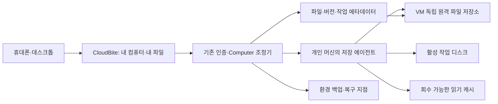
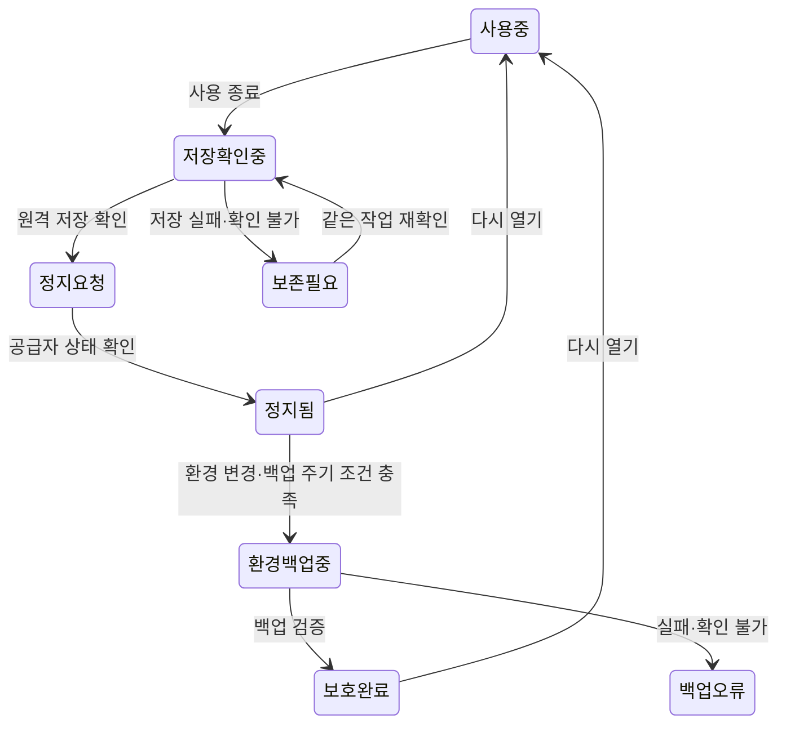

# CloudBite 자동 저장·파일 온디맨드 구현 계획

작성일: 2026-10-19 · 상태: 구현 전 설계 · 관련 작업: T-0067, T-0083, T-0085, T-0086, T-0087

현재 코드 기준: `34bb0b29193d2e9a4301cdac8dcbadd4bce512f1`. 이 문서는 신규 설계이며, 자동 백업·원격 파일 계층이 이미 구현됐다는 뜻이 아니다. 이번 작성에서는 VM 변경, 파일 이동, 백업 생성, 저장소 구매·생성을 하지 않는다.

## 1. 만들 경험과 결정

사용자는 **내 컴퓨터 열기 → 평소처럼 작업 → 사용 종료**만 수행한다. 파일 목록은 전체가 보이고, 파일 열기나 프로젝트 실행에 맞춰 필요한 내용을 가져온다. 이름을 매번 정해 스냅샷을 찍는 절차는 기본 흐름에서 없앤다.

핵심 결정은 **컴퓨터 환경, 사용자 파일 원본, 작업용 디스크, 재사용 캐시를 분리**하는 것이다.

| 구분 | 보관할 것 | 생명주기 |
|---|---|---|
| 기본 환경 이미지 | OS·공통 CLI·런처·글꼴·입력기 | 검증된 릴리스별 재사용 |
| 개인 환경 | 앱 설정·설치 변경·브라우저/CLI 프로필 | 기존 영속 디스크 우선, 변경 시 비공개 환경 백업 |
| 내 파일 원본 | 문서·프로젝트 파일·대형 데이터·모델 | VM과 독립된 원격 저장소 |
| 활성 작업 디스크 | 실행 중인 프로젝트·작업 DB·빌드 산출물·수정 중 파일 | 빠른 로컬 파일시스템, 변경분 저장 확인까지 보존 |
| 읽기 캐시 | 원격 원본에서 다시 가져올 수 있는 데이터 | 용량 목표에 따라 자동 회수 |
| 복구 기록 | 환경 백업·파일 버전·복구 지점 manifest | 개수·기간·실제 바이트 한도로 관리 |

새로운 고유 파일이 계속 늘면 원격 원본 용량도 늘어난다. 목표는 사용하지 않는 파일의 VM 상주와 백업 중복을 줄이고, 총용량·비용 증가를 측정·제어하는 것이다. 무제한 저장이나 임의의 절감률은 약속하지 않는다.

## 2. 현재 구현과 차이

- `ComputerService.stop()`은 영속 디스크를 남기는 정지이며, 자동 원격 업로드·환경 백업을 수행하지 않는다.
- `snapshot()`은 정지 후 전체 파일시스템 cold capture를 요청한다. 기존 어댑터는 `includeMemory:false`를 사용한다. RAM·열린 프로세스 복원은 이번 MVP 범위에서 제외한다.
- 스냅샷 선택은 같은 계정에서 **새 컴퓨터가 필요할 때** 사용하는 원본 선택이다. 현재 머신의 즉시 롤백 UI가 아니다.
- 이력 최대 20개는 로컬 기록의 개수 제한이다. 공급자에 남은 실제 스냅샷 삭제·총바이트 제한까지 구현됐다고 볼 수 없다.
- 현재 개인 머신의 기준 디스크는 10 GiB다. 파일 캐시를 먼저 20 GiB로 잡는 식의 기본값은 사용하지 않는다. 실제 여유 공간을 측정해 OS·프로필·미업로드 변경분을 위한 공간을 먼저 남긴다.
- 세션 만료 alarm과 공급자의 별도 auto-stop이 있다. 사용 종료 버튼에만 저장 로직을 붙이면 만료·강제 정지 경로는 보호되지 않는다.

## 3. 저장 기술 선택

### 검증 순서

1. **Daytona 관리형 Volume**: 현재 계정/리전에서 생성·마운트·재시작·별도 머신 재연결을 먼저 검증한다. 초기 운영 부담을 낮출 후보이다.
2. **사용자 소유 S3 호환 저장소 + 검증된 마운트/전송 도구**: 공급자 이동과 저장 정책 제어를 위한 병행 후보이다. 실제 저장 위치와 왕복 시간·요청 수·전송 비용으로 선택한다.
3. **rclone VFS**: 별도 파일시스템을 개발하지 않고 읽기·캐시 동작을 검증할 후보. 일반 디스크와 같은 의미론·내구성은 별도 시험한다.
4. **JuiceFS**: POSIX 성격의 파일 트리, 큰 파일 집합, 여러 실행 환경 연결이 실제 요구로 확인될 때 검토한다. 메타데이터 엔진 운영·백업까지 포함해야 하므로 첫 단계의 필수 의존성으로 두지 않는다.

Daytona 문서는 Volume을 S3 기반 FUSE 마운트로 설명하고, 외부 저장소 마운트 예시도 제공한다. 그러나 해당 계정의 사용 가능 여부, 실제 읽기 지연, fsync·rename·lock 동작, 마운트 데이터의 스냅샷 포함 여부는 아직 측정하지 않았다. 공식 예제가 있다고 현재 개인 머신에서 작동한다고 간주하지 않는다. [Daytona Volumes](https://www.daytona.io/docs/en/volumes/), [Mount External Storage](https://www.daytona.io/docs/en/mount-external-storage/)

Volume은 로컬 디스크보다 느릴 수 있고 DB 용도로 제약이 있으므로, 브라우저 프로필·SQLite·패키지 설치 디렉터리·Git 작업 트리를 처음부터 통째로 옮기지 않는다. [Daytona Volume limitations](https://www.daytona.io/docs/en/volumes/#limitations)

rclone 캐시 제한은 열린 파일과 주기적 검사 때문에 초과할 수 있다. 옵션 하나로 디스크 사용량의 절대 상한이 보장된다고 표시하지 않는다. JuiceFS에서도 로컬 writeback을 켜면 원격 반영 전 로컬 장애에 대한 데이터 손실 위험이 생긴다. 초기 기본값은 안전한 원격 저장 확인을 우선한다. [rclone VFS](https://rclone.org/commands/rclone_mount/#vfs-file-caching), [JuiceFS cache](https://juicefs.com/docs/community/guide/cache/)

### 선택 게이트

후보마다 동일한 시험표를 작성하고, 통과한 어댑터 하나만 MVP 쓰기 경로로 사용한다. 자동 공급자 fallback으로 저장 위치를 바꾸지 않는다.

| 확인 항목 | 통과 조건 |
|---|---|
| 계정·마운트 권한 | 실제 계정/리전에서 지원. 관리형 마운트와 사용자 FUSE 권한은 각각 확인 |
| 파일 동작 | 한글 경로·빈 디렉터리·권한·rename·삭제·큰 파일·랜덤 읽기 동작을 명시 |
| 저장 확인 | 공급자 반영 완료와 로컬 버퍼 기록을 구분할 관측 수단 존재 |
| 복구 | 재시작·네트워크 단절·중복 응답 뒤 내용 일치 |
| 격리 | 사용자/계정별 소유권 확인, 다른 경로·저장소로 접근 불가 |
| 스냅샷 경계 | 마운트 원본/캐시가 실제 환경 스냅샷에 포함되는지 실험으로 판정 |
| 운영비 | 원본·버전·요청·전송·메타데이터·VM 캐시 비용을 함께 산출 |

투명 마운트가 불가하거나 의미론을 통과하지 못하면 **전체 파일 목록 + 열 때 로컬로 가져오는 파일 서비스**를 먼저 제공한다. 이를 투명한 일반 파일시스템 지원으로 표시하지 않는다.

## 4. 구성과 데이터 흐름



- 기존 Worker/DO는 인증·소유권·작업 ID·진행 상태·종료 조정을 담당한다. 파일 본문과 전체 파일 트리를 기존 단일 머신 레코드에 넣지 않는다.
- 별도 `CatalogStore`에 파일·버전·이동/삭제·동기화 작업을 보관한다. MVP 제어용 SQL 구현은 D1을 우선 검토하되, 실제 인덱스 크기·일괄 갱신·조건부 버전 확정 시험 후 확정한다. JuiceFS를 선택하면 그 파일시스템의 메타데이터와 역할을 분리한다.
- 대용량 본문은 원격 저장소와 에이전트가 직접 전송한다. 짧은 수명의 최소 권한을 사용하며 기존 API 키·구독 토큰을 파일 작업 정의나 브라우저에 노출하지 않는다.
- 기존 개인 머신은 보존한다. MVP는 한 workspace에 쓰기 머신 한 대로 시작하고, GPU 작업 머신은 필요한 입력만 읽고 결과를 별도 산출물로 저장한다.

### 최소 데이터 계약(제안)

| 레코드 | 핵심 필드 |
|---|---|
| Workspace | owner, account, storageBinding, canonicalRevision, writerMachine, writerEpoch |
| FileEntry | fileId, parentId, name, kind, size, mtime, currentVersion, remoteState |
| FileVersion | versionId, immutableObjectRef, contentHash, commitReceipt, retentionClass |
| LocalCopy | machineId, fileId, versionId, presentBytes, dirtyBytes, pinned, lastAccess |
| SyncOperation | requestId, writerEpoch, baseVersion, phase, retryState, verifiedBytes |
| RecoveryPoint | environmentCaptureId, fileRevision, consistencyLevel, verifiedAt |
| RetentionPolicy | sourceQuota, versionQuota, cacheTarget, freeSpaceReserve, retentionCount, retentionAge |

파일명·경로만으로 식별하지 않는다. rename 이후에도 fileId를 유지하고, 같은 이름이더라도 다른 버전은 구분한다. 이름 정규화 충돌·symlink 경계·경로 탈출도 검사한다.

## 5. 파일 온디맨드 동작

### 탐색과 열기

1. 내 파일을 열면 페이지 단위의 파일명·크기·날짜·원격/상주 상태를 가져온다. 디렉터리 조회가 전체 본문 다운로드를 유발하면 실패다.
2. 미리보기는 별도 작은 산출물을 사용한다. 없을 때 모든 원본을 자동으로 읽어 생성하지 않는다. 생성이 필요하면 명시적 미리보기 동작과 전송량 제한을 적용한다.
3. 파일 더블클릭/열기는 필요한 버전을 로컬 작업 경로에 준비한 뒤 원격 데스크톱의 해당 앱으로 연다. 대용량 랜덤 읽기는 어댑터가 지원하는 범위에서 부분 읽기를 사용한다.
4. 프로젝트 실행은 해당 프로젝트 작업 집합을 활성화한다. 일반 앱과 CLI는 이 로컬 경로를 사용한다. 프로젝트를 열었다고 모델·데이터·의존성을 모두 예열하지 않는다.
5. 자주 쓰는 폴더에는 ‘항상 사용 가능’을 제공하고, 사용자가 해제하면 원격 저장 확인 후 공간 회수 대상이 된다.

투명 마운트의 파일 읽기만으로 ‘사용자의 명시적 의도’를 완벽히 식별할 수는 없다. 썸네일러·검색·백신·AI 인덱서도 읽기 요청을 만든다. 따라서 기본 정책은 원격 보관 영역의 자동 색인/썸네일 생성 제외, 활성 프로젝트 범위의 색인 허용, 전송량 관측이다. 엄격한 명시적 로딩이 필요한 보관 영역은 메타데이터 카탈로그를 사용한다.

### 저장과 충돌

```text
remote-only → fetching → available → dirty → uploading → remote-verified
                                    ↘ failed/retryable
```

- 파일을 수정하면 로컬 변경분과 작업 ID를 먼저 내구성 있게 기록한다. 업로드 중인 파일은 회수 대상이 아니다.
- 객체 저장소 경로에서는 임시/불변 버전으로 전송 → 크기와 내용 검증 → 기준 버전·writerEpoch 확인 → canonical 버전 확정 순서를 따른다. ETag를 모든 저장소에서 내용 해시로 간주하지 않는다.
- 본문 저장과 메타데이터 확정은 서로 다른 트랜잭션이다. 중간 장애는 작업 ledger로 복구하고, 참조되지 않은 임시 객체는 유예 후 별도 GC로 처리한다.
- 같은 기준 버전을 다른 쓰기가 바꾸면 덮어쓰기 대신 충돌 사본을 남긴다. MVP에서 다중 writer의 last-write-wins를 허용하지 않는다.
- 관리형 Volume 경로도 영속화 확인과 canonical 파일 버전 의미론을 시험해야 한다. 원시 마운트의 직접 동시 쓰기를 위 계약과 동등하다고 간주하지 않는다.
- writer lease 만료만으로 이전 머신이 쓰기를 멈췄다고 판단하지 않는다. 이전 writer의 정지·권한 차단이 확인되지 않으면 새 쓰기 머신으로 승격하지 않는다. 읽기 전용 clone은 권한이 실제 강제될 때만 제공한다.

## 6. 사용 종료·자동 백업

사용자에게는 ‘사용 종료’ 버튼과 실제 저장 상태를 보여준다. 탭을 닫는 동작은 연결 종료이며, 파일 전송이나 provider stop 완료를 보장하는 신호로 사용하지 않는다. `beforeunload` 요청만으로 저장을 약속하지 않는다.



1. 에이전트가 새 관리 작업·업로드 접수를 잠시 제한하고 현재 파일 전송을 drain한다. 앱의 메모리에만 있는 미저장 내용을 자동 저장했다고 간주하지 않는다.
2. 파일 저장 확인 상태를 원격 기록한다. 네트워크 불명확이면 ‘저장 확인 필요’로 남긴다.
3. 확인 후 provider stop을 요청한다. 중복 클릭·재시도·DO 재기동은 동일한 종료 작업으로 조정한다.
4. 정지 확인 후 개인 환경이 바뀌었고 백업 조건이 충족되면 비공개 환경 스냅샷을 만든다. 동일 환경·잦은 종료에는 중복 작업을 합치며 파일 변경만으로 매번 전체 환경을 복제하지 않는다.
5. 파일 원본과 스냅샷 경계 검증에 따라 마운트/캐시를 분리한다. 공급자의 전체 capture API에 임의의 exclude 옵션이 있다고 가정하지 않는다. 필요한 경우 검증된 clean 캐시만 비우고 capture한다.
6. 환경 백업이 끝나기 전 다시 열기를 요청하면 snapshot/start 상호 배제를 조정한다. 파일 저장 완료와 환경 백업 완료는 별도 상태다. 백업 실패는 원본 디스크·파일 원본을 삭제할 이유가 되지 않는다.

현재 만료 alarm의 즉시 stop 동작은 저장 상태 기계와 연결해야 한다. 지속 업로드·만료 전 여유 시간의 drain·정지 후 디스크 기반 재시작 복구를 함께 구현한다. 공급자 auto-stop/장애로 에이전트가 먼저 멈출 수도 있으므로, 미업로드 변경분은 영속 디스크에서 복구하며 **임시 머신 삭제를 자동 수행하지 않는다**.

지출 상한 때문에 계속 실행할 수 없으면 디스크를 보존한 정지를 선택하고 ‘원격 저장 미확인’ 상태를 남긴다. 저장 실패를 숨기면서 무기한 유료 실행하거나 성공으로 표시하지 않는다. 강제 삭제·원본 이동 완료 판정은 별도 조건을 통과해야 한다.

RAM·열린 창 보존은 현재 container/cold snapshot 경로와 구분한다. 메모리 보존이 꼭 필요하면 계정에서 사용 가능한 VM pause/hot snapshot을 별도 검증한다. [Daytona Persistence](https://www.daytona.io/docs/en/persistence/)

## 7. 캐시·용량·백업 보관 정책

초기 값은 PoC 측정 후 정한다. 모든 예시는 정책 후보이며 이미 적용된 설정이 아니다.

- 캐시 목표는 실제 남은 공간을 기준으로 계산한다: `max(0, freeBytes - systemReserve - dirtyReserve - activeWorkReserve)` 이내에서 설정한다. 작업 집합과 미업로드 변경분도 같은 디스크를 차지한다.
- 총 여유 공간이 부족하면 clean 캐시 회수 → 새 대형 다운로드/예열 제한 → 사용자에게 원인 표시 순서를 따른다. dirty·pinned·사용 중 파일을 강제 삭제하지 않는다.
- 자동 환경 백업은 예를 들어 최근 성공본 3개와 별도 고정본을 시작 후보로 삼되, 실제 snapshot 크기와 provider quota를 측정해 확정한다. 주기·변경 감지·동시 1건·비용 한도를 함께 둔다.
- 최신 복구 가능본, 사용자 고정본, 진행 중 복원에 참조된 버전은 GC에서 보호한다. 새 백업이 검증되기 전 기존 정상 백업을 지우지 않는다.
- 기존 사용자 스냅샷·출처 불명 자원은 자동 GC 범위에서 제외한다. 새 정책이 소유권을 확실히 기록한 자동 생성 자원만 삭제 후보로 삼는다.
- 파일 버전·휴지통·multipart 미완료 업로드·고아 객체를 각각 집계한다. 공급자 버전 관리와 앱 버전 관리를 동시에 켤 때 중복 보관량을 계산한다.
- 내용 해시만 도입했다고 provider 환경 스냅샷이 증분·중복 제거된다고 주장하지 않는다. 바이트 절감은 실제 청구/사용량 비교로 검증한다.
- 종료 시 전체 파일 hash/scan을 반복하지 않는다. 변경 journal과 확인용 주기적 대조를 사용하고, watcher 누락·rename·대량 복사·다른 프로세스 쓰기를 시험한다.

## 8. 복구·이전과 보안

복구 지점은 환경 capture와 파일 버전/revision을 함께 참조한다. 실행 중 앱이 열린 상태의 파일 저장과 디스크 capture를 조합했다고 앱 일관성이 자동 보장되지는 않는다. `files-verified`, `filesystem-crash-consistent`, `app-quiesced` 등 실제 검증 수준을 구분한다.

1. 새 저장 계층은 테스트 데이터로 먼저 검증한다. 기존 개인 머신은 정지·재생성·덮어쓰기하지 않는다.
2. 파일 복사는 원본 유지 → 원격 전송 → 목록/크기/내용 대조 → 새 경로를 읽기 전용으로 검토 → 선택적 쓰기 전환 순서로 진행한다. 전환 시 짧은 쓰기 중단 구간으로 최종 변경분을 대조한다.
3. Git·SQLite·브라우저 프로필·키링은 로컬 작업 디스크에서 검증한다. 기존 앱 로그인 유지 여부는 별도 실제 시나리오로 확인한다.
4. 복원은 새 임시 환경에 먼저 수행하고 파일·권한·프로필을 확인한다. 확인된 전환 절차 전에는 원본 머신을 폐기하지 않는다.
5. NAS/외장하드는 이후 `StorageAdapter` 또는 별도 동기화 대상으로 확장한다. 사용자 로컬 PC가 켜져 있어야만 동작하는 의존성을 기본 경로에 넣지 않는다.

개인 환경 백업에는 OAuth·브라우저 자격증명이 들어갈 수 있다. 백업과 파일은 비공개로 보관하고, 전송/저장 암호화·최소 권한·키 회전·짧은 수명 capability를 적용한다. 캐시도 민감 데이터로 취급한다. 캐시 암호화·기기 폐기 절차와 키가 함께 유실되지 않는 복구 경로를 검증한다. 경로·파일 본문·토큰은 운영 로그와 비용 텔레메트리에 넣지 않는다.

## 9. 단계별 구현과 완료 기준

| 단계 | 작업·산출물 | 완료 기준 | 관련 Task |
|---|---|---|---|
| P0-A | 테스트 전용 Volume/외부 저장소 어댑터 PoC와 비교표 | 권한·파일 의미론·원격 저장 확인·마운트/스냅샷 경계·비용 관측 통과. 실패 시 이유와 대체 경로 명시 | T-0087 |
| P0-B | 파일 카탈로그·버전/작업 계약·가짜 저장소 fault tests | 파일명 목록 조회에 본문 전송 없음, 소유권·경로·버전 충돌·중복 요청 처리 | T-0087 |
| P1-A | 내 파일 열기·프로젝트 활성화·pin·clean 캐시 회수 | 열기 전 전송량, 열 때 필요 데이터, 재열기 cache hit, 공간 부족/색인 동작 실측 | T-0087 |
| P1-B | 저장 에이전트·종료 drain·만료/강제 정지 복구 | 성공 표시 파일은 원격 내용 검증, 미확인 파일은 보존, 중복 종료/장애 복구 통과 | T-0086·T-0087 |
| P1-C | 환경 변경 감지·자동 백업·실제 자원 보관 정책 | 종료마다 사용자 입력 없음, 변경 없는 중복 백업 억제, 최신 정상본 보존, 소유 자원만 GC | T-0085·T-0086 |
| P2-A | 별도 환경 복원과 기존 머신 점진 이전 | 테스트 clone에서 복원 검증, 실패 시 원래 디스크로 복귀, 실제 계정별 권한 확인 | T-0085 |
| P2-B | 모바일 실사용·전체 성능/비용 평가 | 실폰 파일 열기·종료·재접속, warm/cold/복구별 p50/p95와 비용/저장량 보고 | T-0083·T-0084 |

구현 순서는 **P0 두 경로 → P1-A/B → P1-C → P2**다. 원격 저장 확인과 장애 복구가 검증되기 전에는 자동 회수를 켜지 않는다.

첫 PoC의 실행 계획은 임시 CPU 머신 1대·최대 1시간, 합성 사용자 데이터 최대 2 GiB, GPU 사용 없음으로 시작한다. 이 수치는 계획상의 시작 한도이며 이번 문서 작성에서 자원을 만들지는 않는다. 환경 이미지·스냅샷·작업용 중복 공간은 데이터 2 GiB와 별도로 집계한다. 가격/계정 한도가 확인되지 않으면 임대·백업 반복을 자동으로 늘리지 않는다. 시험이 끝나도 미확인 변경분이 있으면 보존 표시와 정지를 우선하며 자동 삭제하지 않는다.

병렬 작업을 진행할 때의 소유 범위:

- 저장 어댑터·마운트 검증 담당: 새 어댑터/PoC만 소유, 기존 개인 머신 lifecycle 수정 금지.
- 카탈로그·버전 담당: 계약/메타데이터/일관성 테스트만 소유, GUI·provider 생성 코드 수정 금지.
- 내 파일 UI 담당: 계약 fixture 기반 목록·열기·pin·상태 표시. 실제 자원 생성·삭제 금지.
- 종료·백업 담당: 저장 계약 확정 후 `ComputerService` lifecycle·alarm을 단독 소유. 다른 작업자는 같은 파일을 수정하지 않음.
- 조정자는 계약·오류 코드·임계값을 먼저 고정하고 통합/복구 테스트를 담당한다. 실제 하위 작업자를 사용할 경우 저장소 AGENTS.md의 StackBite Claude Opus 5.5 medium 설정을 따른다. 이번 문서 작성에서 작업자를 실행했다고 주장하지 않는다.

## 10. 구현 파일 지도와 API 초안

아래 신규 파일명·경로는 제안이며 기존 API 호환성을 유지한다. 큰 파일 전송을 Worker 단일 요청에 붙이지 않는다.

| 위치 | 예정 변경 |
|---|---|
| `src/cloudbite-computer-contract.ts` | 저장/종료·복구 상태 요약과 안전한 오류 코드 |
| `src/cloudbite-computer-service.ts` | `stopMachine`·`stop`·`alarm`과 종료 작업 상태 조정 |
| `src/cloudbite-computer-daytona.ts` | 실제 검증된 Volume/마운트/백업 조회·소유 자원 정리 어댑터 |
| `src/cloudbite-computer-files-contract.ts` (신규) | 파일·버전·작업·캐시 계약 |
| `src/cloudbite-computer-files.ts` (신규) | 카탈로그·권한·버전 확정·작업 ledger |
| `images/cloudbite-computer/files-agent.py` (신규) | 로컬 작업 집합·전송·변경 journal·flush/복구 상태 |
| `images/cloudbite-computer/start-desktop.py` | 저장 에이전트 건강 확인. 마운트 실패 시 빈 폴더를 정상 파일 목록처럼 보여주지 않음 |
| `src/cloudbite-computer-api.ts` | 기존 인증/Origin 검사를 재사용하는 파일·종료 제어 경로 |
| `client/cloudbite-computer.ts` | 사용 종료·저장 상태·내 파일 진입점. 스냅샷 세부 조작은 고급 흐름 |
| `client/cloudbite-computer-files.ts` (신규) | 메타데이터 목록·열기/다운로드 진행·pin·버전 상태 |
| `src/cloudbite-computer-costs.ts` / 대응 UI | 원격 원본·버전·캐시·환경 백업·전송 비용의 분리 |
| `test/cloudbite-computer-files*.mjs` 및 agent tests (신규) | 데이터 보존·충돌·내구성·회수 계약 검증 |

API 초안: `GET files?parentId&cursor`, `POST files/open`, `POST files/pin`, `GET storage/status`, `POST session/end`, `GET session/end/:requestId`. 변경 요청은 기존과 같은 소유자 인증·정확한 Origin·requestId 의미론을 유지한다. `files/open`은 비용/범위 제한 안에서만 데이터를 준비하며 프로그램/경로 문자열을 임의 셸 명령으로 실행하지 않는다.

기존 `stop` 호환성과 의미 변경은 명시적으로 마이그레이션한다. GET은 관측만 하며 파일 로드·삭제·새 컴퓨터 생성으로 숨겨진 동작을 만들지 않는다.

## 11. 측정 계획과 출시 게이트

실측 전 목표값은 성능 보장이 아니다. 5초는 같은 기기에서 열기 클릭 → 입력 가능한 작업 공간까지의 지표로 따로 측정하고, 파일 목록만 빨리 그렸다고 달성으로 계산하지 않는다.

| 시험 | 수집할 증거 |
|---|---|
| 합성 디렉터리 10,000개 항목 | 페이지 표시 p50/p95, 메타데이터 요청 수, 원본 본문 전송 0 |
| 작은 문서·1 GiB 파일·랜덤 부분 읽기 | 첫 사용 대기, 전송 바이트, 재열기 cache hit, 전체 다운로드 여부 |
| Git repo·다수 작은 파일·한글 파일명 | 실제 CLI 작업, rename·권한·case 충돌·색인 영향 |
| 종료 20회 및 같은 환경 반복 종료 | 백업 생성 수·실제 저장 바이트·quota, 단순 이력 개수와 구분 |
| 전송 도중 단절·agent 종료·VM 정지 | 미업로드 보존, 재기동 복구, 원격 성공 판정의 정확성 |
| DO 재기동·중복 요청·응답 유실 | 작업/버전 중복 없음, 불명확한 결과 재확인, 상태 역행 없음 |
| 저장소 quota·로컬 공간 고갈 | dirty 파일 무삭제, 새 전송 억제, 복구 가능한 오류 표시 |
| 동시 열기·이전 writer 늦은 응답 | canonical 버전 덮어쓰기 없음, 새 writer 승격 전 확인 |
| 원본을 보존한 별도 복원 | 내용 해시·권한·프로필 상태, 환경/파일 버전 참조 일치 |
| 브라우저 닫기·실폰 네트워크 전환 | 화면 재접속과 백엔드 저장/종료 상태를 분리해 검증 |

벤치마크는 초기 탐색 표본과 출시 반복 표본을 구분한다. warm/캐시 적중, cache miss, stopped resume, cold create, 복구를 각각 최소 30회 목표로 기록하되, 실제 유료 반복 실행은 사전 명시된 한도에서만 수행한다. 표본 부족·quota 거절·실패는 숨기지 않는다. p95와 함께 n·실패율·기기/리전·시각·데이터 크기를 기록한다.

출시 게이트:

1. 원격 저장 확인을 성공으로 표시한 데이터에 대한 장애 주입 시험에서 내용 손실 없음. RAM 미저장 작업이나 provider 전체 장애까지 RPO 0을 주장하지 않는다.
2. 원격 저장 미확인 데이터에 대한 자동 캐시 삭제·원본 머신 폐기 없음.
3. 파일 목록 탐색이 전체 데이터 로드로 변하지 않음. 앱 색인 등 예외 읽기량도 계측됨.
4. 새 정상 백업 검증 전 이전 정상본 삭제 없음. 삭제 실패·불명확 결과도 ledger로 조정됨.
5. 실행/저장/백업 성공 표시가 각각 실제 관측과 일치. 테스트 fixture와 운영 실측 구분.
6. 기존 개인 컴퓨터 보존, opt-in 방식의 점진 전환, 동기화 쓰기 전환을 되돌릴 절차 검증.

## 12. 비용 모델과 미확정 사항

월 비용은 `컴퓨팅 사용시간 + 남겨 둔 VM 디스크 + 원격 고유 원본 + 파일 이전 버전/휴지통 + 환경 백업 + 객체/API 요청 + 전송 + 메타데이터 운영`을 합산한다. 물리 저장의 중복 제거 여부가 확인되지 않으면 버전별 바이트를 합산한다. 읽기 캐시가 VM 디스크와 같은 과금 단위일 때 이를 별도 스토리지 비용으로 다시 더하지 않는다.

현재 방식과 비교할 지표는 VM 상주 바이트, 백업 물리 바이트, 고유 원본 바이트, 요청/전송량, 종료·첫 열기 지연이다. 무료 크레딧 잔액은 장기 단가에서 제외하고 공급자 실제 요금·리전·계정 quota를 별도로 확인한다. 저장량만 줄고 요청/전송 비용과 대기 시간이 더 커지는 구성은 채택하지 않는다.

미확정: 현재 계정 Volume 사용 가능 여부와 리전, 마운트/전체 capture 경계, 원격 저장 확인 API, 캐시의 실제 위치·암호화, 객체 저장소 최종 선택, 환경 변경 감지 범위, 버전/백업 보관 수와 용량 한도, 다른 provider에서의 재연결, RAM 보존 필요성. 이는 P0 검증 결과로 확정하며 문서 작성만으로 완료 처리하지 않는다.

## 근거와 재개

- 현재 동작: [개인 컴퓨터 가이드](personal-computer.md), [스냅샷 계약](computer-snapshots.md), [모바일 접속 복구](mobile-stability.md).
- 외부 문서는 2026-10-19 확인: [Daytona Persistence](https://www.daytona.io/docs/en/persistence/), [Volumes](https://www.daytona.io/docs/en/volumes/), [Mount External Storage](https://www.daytona.io/docs/en/mount-external-storage/), [rclone mount](https://rclone.org/commands/rclone_mount/), [JuiceFS cache](https://juicefs.com/docs/community/guide/cache/).
- 구현 재개 시 P0-A/B부터 수행한다. 시험용 자원 소유권·보존/회수 범위를 기록하고, 기존 개인 머신·로그인 프로필은 유지한다. 기존 guarded 배포와 별도 전문가 작업대 변경을 보존한다.
